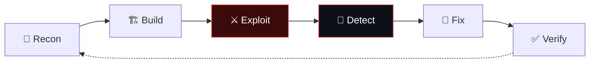

<div align="center">

<a href="https://n4khla.github.io">
  
</a>

<br/>

<a href="https://n4khla.github.io"></a>
<a href="https://www.linkedin.com/in/guerfi-ahmed-yacine-6831b32b8/"></a>
<a href="mailto:ay.guerfi@esi-sba.dz?subject=Internship%20opportunity"></a>
<a href="https://n4khla.github.io/Guerfi_Ahmed_Yacine_CV.pdf"></a>

</div>

<br/>

## `> whoami`

```yaml
name:        Guerfi Ahmed Yacine
role:        Cyber Security Engineering Student
degree:      State Engineer + Master's
school:      ESI Sidi Bel Abbès · class of 2027
focus:       [offensive, detection, mobile AppSec]
approach:    build → exploit → detect → prove the fix
status:      OPEN_TO_INTERNSHIPS  # pentest · AppSec · SOC
```

- 🛡️ I work where **offensive security, detection and software engineering** meet
- 🔬 Every project ships with a harness, tests or a benchmark: claims that can fail
- 🎯 Currently studying **detection engineering, iOS internals** and ML that holds up outside a notebook
- 📫 Hiring a security intern? **[ay.guerfi@esi-sba.dz](mailto:ay.guerfi@esi-sba.dz)**

<br/>

## `> ls ./engagements`

<table>
  <tr>
    <td width="33%" valign="top">
      <h3><a href="https://github.com/N4khlA/Race_condition_exploiter">⚔️ Race Condition Exploiter</a></h3>
      <sub><code>OFFENSIVE / WEB</code></sub>
      <p>A full TOCTOU lab: a shop with <b>5 real race bugs</b>, an exploit harness with <b>4 concurrency strategies</b> (incl. HTTP/2 multiplexing), <b>3 detectors</b> and DB-level fixes benchmarked for exploit rate vs latency.</p>
      
      
      
      
    </td>
    <td width="33%" valign="top">
      <h3><a href="https://github.com/N4khlA/AI-_threat_hunting">🧠 ML Intrusion Detection</a></h3>
      <sub><code>DEFENSIVE / ML</code></sub>
      <p>End-to-end IDS on UNSW-NB15: Random Forest <b>(macro F1 0.948)</b> vs BiLSTM <b>(AUC 0.998)</b> with a McNemar test, FastAPI serving, live monitoring and a retrain guard. <b>49 tests.</b></p>
      
      
      
    </td>
    <td width="33%" valign="top">
      <h3><a href="https://github.com/N4khlA/MobileApp_SecAnalyzer">📱 masa</a></h3>
      <sub><code>MOBILE APPSEC</code></sub>
      <p>Mobile App Security Analyzer: <b>78 rules</b> mapped to the OWASP Mobile Top 10, hand-written AXML / plist / DEX / ELF / Mach-O parsers, <b>SARIF output</b> and a <code>--fail-on</code> CI gate. Zero dependencies.</p>
      
      
      
    </td>
  </tr>
</table>

<br/>

## `> cat ./arsenal.txt`

<div align="center">


<br/><br/>


<br/><br/>


</div>

<br/>

## `> ./tradecraft --loop`



<br/>

## `> tail -f activity.log`

<div align="center">


<br/><br/>

<picture>
  <source media="(prefers-color-scheme: dark)" srcset="https://raw.githubusercontent.com/N4khlA/N4khlA/output/github-snake-dark.svg"/>
  
</picture>

</div>

<br/>

<div align="center">

<sub>🔐 Offensive tooling here is for authorised education and research, run in isolated labs.</sub>

</div>


