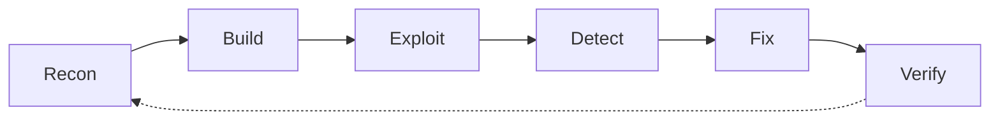

`SEC-ASSESSMENT // GUERFI-A-Y` · `PUBLIC` · `REV 2026.10` · `AVAILABLE FOR INTERNSHIP`

# Guerfi Ahmed Yacine

**Cyber security engineering student at ESI Sidi Bel Abbès · class of 2027**

| FIELD | VALUE |
|---|---|
| **Focus** | Offensive security · applied ML · mobile AppSec |
| **Base** | Sidi Bel Abbès, Algeria |
| **Graduation** | 2027 |

> **Field report.** I build the vulnerable system, exploit it, instrument the
> detection, then prove the fix under load. The repositories below are the
> evidence, not a skills list.

`01` [Summary](#summary) · `02` [Engagements](#engagements) · `03` [Tradecraft](#tradecraft) · `04` [Field notes](#field-notes) · `05` [Currently](#currently) · `06` [Contact](#contact)

---

## Summary

I'm a final-year cyber security engineering student at **ESI Sidi Bel Abbès**,
graduating in **2027**. I work where offensive security, detection engineering
and software engineering meet: race conditions, mobile attack surfaces, and ML
detectors that have to survive real traffic.

I care about claims that can be checked. Every project here ships with a harness,
a test suite, a benchmark or a CI gate — something that can fail and prove the
work is real.

> **Rules of engagement.** Offensive work stays in isolated labs. Datasets are
> public or synthetic. If a claim cannot be reproduced, it does not go on this page.

---

## Engagements

| ID | Engagement | Domain | Evidence | State |
|---|---|---|---|---|
| `F-01` | **[Race Condition Exploiter](https://github.com/N4khlA/Race_condition_exploiter)** | Offensive web | 5 TOCTOU bugs · 4 strategies · 3 detectors · 7 labs | `SHIPPED` |
| `F-02` | **[ML Network Intrusion Detection](https://github.com/N4khlA/AI-_threat_hunting)** | Defensive ML | RF macro-F1 0.948 · LSTM AUC 0.998 · 49 tests | `SHIPPED` |
| `F-03` | **[masa: Mobile App Security Analyzer](https://github.com/N4khlA/MobileApp_SecAnalyzer)** | Mobile AppSec | 78 rules · OWASP M1–M10 · SARIF + severity gate | `MAINTAINED` |

<code>F-01</code> · Race Condition Exploiter <code>OFFENSIVE / WEB</code>

**Thesis.** Most race-condition demos stop at a screenshot. This one is a full
shop with five exploitable TOCTOU paths, a harness that can replay them, and
fixes that can be toggled and benchmarked on the same load.

**Evidence**
- Five bugs: double-spend, coupon reuse, oversell, duplicate signup, reset-token reuse.
- Four concurrency strategies: asyncio, barrier-synced threads, raw TCP and HTTP/2 multiplexing.
- Three independent detectors: request-pattern middleware, PostgreSQL invariant triggers and byte-identical fingerprinting.
- Fix modes include compare-and-swap, row locks, optimistic locking, serializable isolation and Redis locks — measured for exploit rate vs. latency.

`FastAPI` · `PostgreSQL` · `Redis` · `React / TypeScript` · `Docker`

[Repository](https://github.com/N4khlA/Race_condition_exploiter) · [Seven labs](https://github.com/N4khlA/Race_condition_exploiter/tree/main/labs) · [Field reference](https://github.com/N4khlA/Race_condition_exploiter/blob/main/docs/reference.md)

<code>F-02</code> · ML Network Intrusion Detection <code>DEFENSIVE / ML</code>

**Thesis.** An end-to-end IDS on UNSW-NB15 that reports its weak spots instead of
hiding them behind one accuracy number.

**Evidence**
- Random Forest and a bidirectional LSTM compared on the same held-out flows, with an aligned McNemar test.
- Leakage scan, per-attack-family recall, and a retraining pipeline that refuses to replace a model with a worse one.
- FastAPI inference endpoint, Streamlit monitor, and 49 tests covering the pipeline, serving path and retraining guard.

`scikit-learn` · `TensorFlow` · `FastAPI` · `Streamlit` · `pytest`

[Repository](https://github.com/N4khlA/AI-_threat_hunting) · [Model comparison](https://github.com/N4khlA/AI-_threat_hunting/blob/main/reports/model_comparison.md) · [Limitations](https://github.com/N4khlA/AI-_threat_hunting/blob/main/docs/limitations.md)

<code>F-03</code> · masa: Mobile App Security Analyzer <code>MOBILE APPSEC</code>

**Thesis.** A mobile scanner that can fail a build, not just print a PDF.

**Evidence**
- 78 rules mapped to OWASP Mobile Top 10 2023, with 2016 compatibility mappings.
- Hand-written parsers for binary AXML, bplist, DEX, ELF and Mach-O. No runtime dependencies.
- SARIF 2.1.0 output, `--fail-on` severity gate, 34 tests and CI on Python 3.9–3.13.

`Python stdlib` · `OWASP Mobile Top 10` · `SARIF` · `GitHub Actions`

[Repository](https://github.com/N4khlA/MobileApp_SecAnalyzer) · [CI](https://github.com/N4khlA/MobileApp_SecAnalyzer/actions/workflows/ci.yml) · [Changelog](https://github.com/N4khlA/MobileApp_SecAnalyzer/blob/main/CHANGELOG.md)

---

## Tradecraft

The loop I keep coming back to:

| Phase | What I actually do | Where you can see it |
|---|---|---|
| **Recon** | Parse formats by hand; map trust boundaries | `masa` — AXML, bplist, DEX, ELF, Mach-O |
| **Build** | Write the vulnerable target and a repeatable harness | `F-01` — shop + 5 bugs + CLI harness |
| **Exploit** | Race the scheduler, not the UI | `F-01` — asyncio, threads, raw TCP, HTTP/2 |
| **Detect** | Make the exploit leave evidence | `F-01` — 3 detectors · `F-02` — ML IDS |
| **Fix** | Change the invariant, not the timeout | `F-01` — CAS, row locks, serializable, Redis |
| **Verify** | Tests, benchmarks, CI gates | 49 + 34 tests · SARIF `--fail-on` |

---

## Field notes

Three things the work keeps teaching me:

> **Reproduction beats a good story.** If I can't replay it from a clean
> checkout, I don't understand it yet.

> **A fix is a hypothesis until the exploit fails.** The interesting number is
> not "tests pass"; it's "exploit success rate went to zero, and latency stayed
> inside budget."

> **Detection without a false-positive budget is decoration.** A detector that
> fires on everything is just another alert queue.

---

## Currently

- **Shipping** — `masa` 1.1: SARIF output, a `--fail-on` severity gate and CI on Python 3.9–3.13.
- **Studying** — detection engineering, iOS internals and ML models that hold up outside a notebook.
- **Looking for** — an internship where exploitation and detection are both in scope.

---

## Contact

[Email](mailto:ay.guerfi@esi-sba.dz?subject=Internship%20opportunity) · [LinkedIn](https://www.linkedin.com/in/guerfi-ahmed-yacine-6831b32b8/) · [Portfolio](https://n4khla.github.io) · [CV](https://n4khla.github.io/Guerfi_Ahmed_Yacine_CV.pdf) · [security.txt](https://n4khla.github.io/.well-known/security.txt)

Based in Sidi Bel Abbès, Algeria. Open to internship offers, projects and hard problems.

All offensive tooling is for authorised education and research, run in isolated environments. No trackers, no generated stats — this page changes when the work does.
